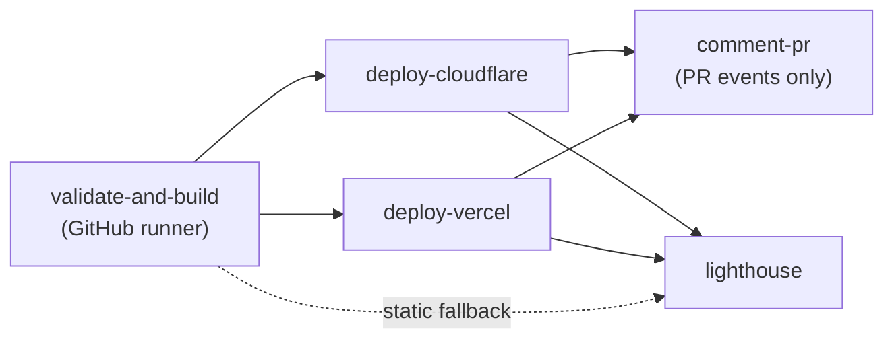

# Usage Guide

This guide covers deploying with the Shared CI/CD Framework. For the project overview, see [README.md](README.md).

Deploy any static or framework-based web application to **Cloudflare Pages** and/or **Vercel** with a single reusable workflow — or compose the individual actions yourself.

The framework handles runtime setup, package-manager and output-directory detection, builds, multi-platform deployment, pull-request preview comments, and Lighthouse audits. Consumers add a ~15-line workflow file and inherit every future improvement through the floating `@v1` tag.

---

## Contents

- [Requirements](#requirements)
- [Quick Start](#quick-start)
- [How a Deployment Runs](#how-a-deployment-runs)
- [Deployment Patterns](#deployment-patterns)
  - [Static or zero-dependency site](#static-or-zero-dependency-site)
  - [Framework application](#framework-application)
  - [Monorepo / subdirectory app](#monorepo--subdirectory-app)
  - [Multi-cloud](#multi-cloud)
  - [Remote builds (quota saver)](#remote-builds-quota-saver)
  - [No build / prebuilt artifacts](#no-build--prebuilt-artifacts)
- [Configuration Reference](#configuration-reference)
  - [Inputs](#inputs)
  - [Secrets](#secrets)
  - [Build-time environment variables](#build-time-environment-variables)
  - [Caller permissions](#caller-permissions)
  - [Environments](#environments)
- [Composite Actions](#composite-actions)
- [Auxiliary Workflows](#auxiliary-workflows)
- [Framework Recipes](#framework-recipes)
- [Troubleshooting](#troubleshooting)
- [Versioning & Releases](#versioning--releases)

---

## Requirements

- A GitHub repository containing a static site or a buildable web app.
- This repository must be accessible to the caller:
  - **Public** — works as-is.
  - **Private / internal** — enable **Settings → Actions → General → Access → Accessible from repositories in the organization**.
- The credentials for whichever platform(s) you enable (see [Secrets](#secrets)).
- The caller workflow must grant `contents: read`, `pull-requests: write`, and `deployments: write` (see [Caller permissions](#caller-permissions)).

---

## Quick Start

### 1. Configure credentials

Add the secrets once at the **organization** level (recommended) or per repository:

> **Organization Settings → Secrets and variables → Actions → New organization secret**

| Secret | Needed when | Notes |
| :--- | :--- | :--- |
| `CLOUDFLARE_API_TOKEN` | Deploying to Cloudflare via Wrangler | Token with `Account → Cloudflare Pages → Edit` |
| `CLOUDFLARE_ACCOUNT_ID` | Deploying to Cloudflare via Wrangler | 32-character hexadecimal account ID |
| `CLOUDFLARE_DEPLOY_HOOK_URL` | Remote Cloudflare builds | Optional; when set, it **takes precedence** over Wrangler |
| `VERCEL_TOKEN` | Deploying to Vercel | Personal or automation token |

If you deploy to Vercel, also add repository **variables** (not secrets):

- `VERCEL_PROJECT_ID`
- `VERCEL_ORG_ID`

### 2. Add the caller workflow

Create `.github/workflows/ci-cd.yml` in your project:

```yaml
name: CI/CD Pipeline

on:
  push:
    branches: [ "main" ]
  pull_request:
    branches: [ "main" ]
  workflow_dispatch:

concurrency:
  group: ${{ github.workflow }}-${{ github.ref }}
  cancel-in-progress: true

permissions:
  contents: read
  pull-requests: write
  deployments: write

jobs:
  deploy:
    uses: LABEIM/shared-ci-cd/.github/workflows/deploy-app.yml@v1
    with:
      enable_cloudflare: true
      cloudflare_project_name: 'my-web-app'
    secrets: inherit
```

Replace `LABEIM/shared-ci-cd` with your fork or organization path if different.

### 3. Push

Push to `main` for a production deployment, or open a pull request for a preview deployment and an automatic PR comment.

---

## How a Deployment Runs



| Stage | Runs when | Timeout | What it does |
| :--- | :--- | :---: | :--- |
| `validate-and-build` | `build_location` is `github`, `auto`, or empty | 15 min | Detects the runtime/package manager, installs, runs the optional check, builds, stages output, uploads `dist-static-build`. |
| `deploy-cloudflare` | `enable_cloudflare` is `true` | 10 min | Deploys via Wrangler or triggers a Deploy Hook, then resolves the live/preview URL. |
| `deploy-vercel` | `enable_vercel` is `true` | 10 min | Deploys prebuilt output via the Build Output API v3, or delegates the build to Vercel. |
| `comment-pr` | `enable_pr_comment` is `true` and the event is `pull_request` | 5 min | Creates or updates the single preview comment. |
| `lighthouse` | `enable_lighthouse` is `true` | 10 min | Audits the deployed URL (Cloudflare first, then Vercel, then static fallback) and reports scores. |

Production vs. preview:

- **Cloudflare** — production when the branch matches `production_branch` (default `main`); `main` and `master` are always treated as production.
- **Vercel** — production for every non-`pull_request` event; preview for pull requests.

The build artifact `dist-static-build` is kept for 3 days.

---

## Deployment Patterns

### Static or zero-dependency site

No `package.json`, no install, no build. The workflow stages root files (or a `public/` folder) automatically.

```yaml
jobs:
  deploy:
    uses: LABEIM/shared-ci-cd/.github/workflows/deploy-app.yml@v1
    with:
      enable_cloudflare: true
      cloudflare_project_name: 'my-static-site'
    secrets: inherit
```

If your files live somewhere non-standard, set `dist_dir` explicitly (for example `dist_dir: 'public'`).

### Framework application

```yaml
jobs:
  deploy:
    uses: LABEIM/shared-ci-cd/.github/workflows/deploy-app.yml@v1
    with:
      node_version: '22'
      package_manager: 'auto'
      build_command: 'npm run build'
      check_command: 'npm run lint'   # optional
      dist_dir: 'auto'
      enable_cloudflare: true
      cloudflare_project_name: 'my-web-app'
      enable_vercel: false
      lighthouse_routes: |
        /
        /about
        /contact
    secrets: inherit
```

### Monorepo / subdirectory app

```yaml
jobs:
  deploy:
    uses: LABEIM/shared-ci-cd/.github/workflows/deploy-app.yml@v1
    with:
      working_directory: 'apps/web'
      package_manager: 'auto'
      dist_dir: 'auto'
      enable_cloudflare: true
      cloudflare_project_name: 'monorepo-web-app'
    secrets: inherit
```

> [!NOTE]
> Lockfile detection runs **inside `working_directory`**. If your workspace keeps a single lockfile at the repository root (common with pnpm/yarn workspaces), set `package_manager` explicitly — otherwise it falls back to npm.

### Multi-cloud

Both platforms deploy in parallel from the same build:

```yaml
jobs:
  deploy:
    uses: LABEIM/shared-ci-cd/.github/workflows/deploy-app.yml@v1
    with:
      package_manager: 'auto'
      dist_dir: 'auto'

      enable_cloudflare: true
      cloudflare_project_name: 'production-store'

      enable_vercel: true
      vercel_project_id: ${{ vars.VERCEL_PROJECT_ID }}
      vercel_org_id: ${{ vars.VERCEL_ORG_ID }}
    secrets: inherit
```

### Remote builds (quota saver)

For private repositories with limited GitHub Actions minutes, skip the GitHub build entirely and let the platform compile.

**Vercel remote build** — consumes 0 GitHub build minutes:

```yaml
with:
  build_location: 'vercel'
  enable_vercel: true
  vercel_project_id: ${{ vars.VERCEL_PROJECT_ID }}
  vercel_org_id: ${{ vars.VERCEL_ORG_ID }}
  enable_cloudflare: false
```

**Cloudflare remote build** — requires `CLOUDFLARE_DEPLOY_HOOK_URL`:

```yaml
with:
  build_location: 'cloudflare'
  enable_cloudflare: true
  cloudflare_project_name: 'my-cf-app'
  enable_vercel: false
```

> [!IMPORTANT]
> If `CLOUDFLARE_DEPLOY_HOOK_URL` is configured, the Cloudflare job always uses the hook (remote build) instead of Wrangler — regardless of `build_location`.

### No build / prebuilt artifacts

Use `build_location: 'none'` when the output is committed or produced by an earlier job. Cloudflare deploys the existing `dist_dir` contents.

> [!NOTE]
> For Vercel, `'none'` deploys prebuilt output, so the repository must already contain a valid `.vercel/output/` directory. If you want Vercel to compile the project, use `build_location: 'vercel'` instead.

If the resolved directory is missing, empty, or has no `index.html`, the workflow generates a small "Deployment Active" bootstrap page so the deployment does not fail. Treat that page as a signal that your `dist_dir` or `build_command` is wrong.

### Build location comparison

| Strategy | `build_location` | GitHub runner cost | Platform quota used | Best for |
| :--- | :---: | :---: | :---: | :--- |
| GitHub build | `'github'` (default) | Full build | 0 | Public repos, multi-cloud sync, centralized lockfile verification |
| Vercel remote | `'vercel'` | ~CLI trigger only | Vercel build minutes | Private repos, SSR/ISR/Edge on Vercel |
| Cloudflare remote | `'cloudflare'` | Deploy Hook only | Cloudflare free builds | Private repos, Cloudflare Pages git projects |
| No build | `'none'` | Direct upload only | 0 | Vanilla sites, committed/prebuilt artifacts |

---

## Configuration Reference

### Inputs

All inputs are optional unless noted. All are declared under `with:`.

| Input | Type | Default | Description |
| :--- | :---: | :---: | :--- |
| `working_directory` | string | `'.'` | Subdirectory to build/deploy (monorepos). |
| `build_location` | string | `'github'` | `'github'`, `'vercel'`, `'cloudflare'`, or `'none'`. |
| `node_version` | string | `'22'` | Node version, or `'auto'` to read `.nvmrc` / `.node-version`. |
| `package_manager` | string | `'auto'` | `'auto'`, `'npm'`, `'pnpm'`, `'bun'`, `'yarn'`, `'none'`, or `'static'`. |
| `install_command` | string | `''` | Custom install command, or `'none'` to skip. |
| `check_command` | string | `''` | Optional lint/typecheck command (e.g. `npx astro check`). |
| `build_command` | string | `'npm run build'` | Build command; `'none'` skips, `'auto'` runs the package `build` script when present. |
| `dist_dir` | string | `'dist'` | Output directory, or `'auto'` to detect standard folders. |
| `enable_cloudflare` | boolean | `true` | Deploy to Cloudflare Pages. |
| `cloudflare_project_name` | string | `''` | Cloudflare Pages project name (defaults to the repository name). |
| `production_branch` | string | `'main'` | Branch treated as production. |
| `enable_vercel` | boolean | `false` | Deploy to Vercel. |
| `vercel_project_id` | string | `''` | Vercel project ID (required when Vercel is enabled). |
| `vercel_org_id` | string | `''` | Vercel organization/team ID (required when Vercel is enabled). |
| `enable_pr_comment` | boolean | `true` | Post/update the PR preview comment. |
| `enable_lighthouse` | boolean | `true` | Run the Lighthouse audit. |
| `lighthouse_routes` | string | `'/'` | Space- or newline-separated routes to audit. |
| `lighthouse_config_path` | string | `''` | Path to a custom Lighthouse CI config. |

**Output auto-detection order:** `dist` → `out` → `build` → `.output/public` → `_site` → `site` → `public` → root `index.html`.

**Package-manager auto-detection:** `pnpm-lock.yaml` → `bun.lockb` / `bun.lock` → `yarn.lock` → `package-lock.json` / `npm-shrinkwrap.json` → npm; if `package.json` is absent, no install/build is attempted.

### Secrets

Pass them with `secrets: inherit` (organization/repository secrets) or explicitly under `secrets:`.

| Secret | Required | Description |
| :--- | :---: | :--- |
| `CLOUDFLARE_API_TOKEN` | Cloudflare via Wrangler | Token with Cloudflare Pages edit permission. |
| `CLOUDFLARE_ACCOUNT_ID` | Cloudflare via Wrangler | Cloudflare account ID. |
| `CLOUDFLARE_DEPLOY_HOOK_URL` | Cloudflare remote build | Deploy Hook URL; takes precedence over Wrangler. |
| `VERCEL_TOKEN` | Vercel | Vercel personal/automation token. |

Never commit these values. Keep `.env`, `.env.local`, and credential files out of the repository.

### Build-time environment variables

When the site is built on the runner (`build_location: github`, the default), every inherited secret whose name starts with `PUBLIC_` is exported into the build environment before the build command runs. The prefix is case-sensitive: nothing else is exported, and the step logs the exported names only, never the values.

This is how callers pass build-time configuration to frameworks that inline environment variables into the static output. GitHub does not allow the `secrets` context inside `with:`, so the values must arrive through `secrets: inherit`:

```yaml
jobs:
  deploy:
    uses: LABEIM/shared-ci-cd/.github/workflows/deploy-app.yml@v1
    with:
      cloudflare_project_name: 'my-astro-site'
    # PUBLIC_GOOGLE_SHEET_SCRIPT_URL, PUBLIC_RECRUITMENT_SECRET, ... are inherited here
    secrets: inherit
```

An Astro site can then read them at build time:

```astro
---
const sheetUrl = import.meta.env.PUBLIC_GOOGLE_SHEET_SCRIPT_URL;
---
```

> [!WARNING]
> The `PUBLIC_` prefix is only for values intended to ship to the browser. Everything exported this way is inlined into the static output and is readable by every visitor. Never give a token, API key, or deployment credential a `PUBLIC_` name.

### Caller permissions

Declare the minimum permissions at the caller workflow or job level:

```yaml
permissions:
  contents: read        # checkout
  pull-requests: write  # PR preview comment (omit if enable_pr_comment: false)
  deployments: write    # environment/deployment URLs
```

Secrets are not available to `pull_request` runs from forks. If you deploy previews from forks, use `pull_request_target` carefully and never execute untrusted code with secrets.

### Environments

The workflow publishes to GitHub Environments:

- `cloudflare-preview` / `cloudflare-production`
- `vercel-preview` / `vercel-production`

You can attach protection rules (required reviewers, wait timers, deployment branch policies) in **Settings → Environments**.

---

## Composite Actions

Use these directly when you need custom Docker builds, extra gates, or non-standard deployment steps. All actions are composite; call them from an `ubuntu-latest` job.

| Action | Purpose | Key inputs | Outputs |
| :--- | :--- | :--- | :--- |
| [`actions/setup-and-build`](actions/setup-and-build/action.yml) | Runtime setup, dependency install, check, build, stage output, upload artifact | `node_version`, `package_manager`, `install_command`, `check_command`, `build_command`, `dist_dir`, `project_name`, `artifact_name`, `artifact_retention_days` | `artifact_hash`, `build_duration`, `detected_package_manager`, `resolved_dist_dir` |
| [`actions/deploy-cloudflare`](actions/deploy-cloudflare/action.yml) | Wrangler deploy or Deploy Hook trigger, with retries and URL resolution | `project_name` *(optional; defaults to the repository name, sanitized)*, `dist_dir`, `production_branch`, `api_token`, `account_id`, `deploy_hook_url`, `max_retries`, `retry_delay` | `deploy_url`, `is_production` |
| [`actions/deploy-vercel`](actions/deploy-vercel/action.yml) | Build Output API v3 deploy or remote Vercel build | `project_id` *(required)*, `org_id` *(required)*, `vercel_token` *(required)*, `dist_dir`, `remote_build`, `prepare_output`, `max_retries`, `retry_delay` | `deploy_url`, `is_production` |
| [`actions/pr-preview-comment`](actions/pr-preview-comment/action.yml) | Create or update the single preview comment | `cloudflare_url`, `vercel_url`, `custom_message`, `github_token` | — |
| [`actions/lighthouse-audit`](actions/lighthouse-audit/action.yml) | Run Lighthouse CI and summarize scores; static audits resolve `dist_dir` under `working_directory` | `target_url`, `routes`, `config_path`, `dist_dir`, `append_to_pr`, `github_token` | `summary_markdown` |

The reusable [`deploy-app.yml`](.github/workflows/deploy-app.yml) workflow is composed of these same actions, referenced at `@v1`; workflow and actions move together in a release.

Example custom pipeline:

```yaml
jobs:
  build-and-deploy:
    runs-on: ubuntu-latest
    permissions:
      contents: read
      pull-requests: write
      deployments: write
    steps:
      - uses: actions/checkout@v5

      - name: Build site
        uses: LABEIM/shared-ci-cd/actions/setup-and-build@v1
        with:
          package_manager: 'auto'
          build_command: 'npm run build'
          dist_dir: 'auto'

      - name: Deploy to Cloudflare
        id: cf
        uses: LABEIM/shared-ci-cd/actions/deploy-cloudflare@v1
        with:
          project_name: 'my-custom-app'
          dist_dir: 'dist'
          api_token: ${{ secrets.CLOUDFLARE_API_TOKEN }}
          account_id: ${{ secrets.CLOUDFLARE_ACCOUNT_ID }}

      - name: Post PR comment
        if: github.event_name == 'pull_request'
        uses: LABEIM/shared-ci-cd/actions/pr-preview-comment@v1
        with:
          cloudflare_url: ${{ steps.cf.outputs.deploy_url }}
```

---

## Auxiliary Workflows

| Workflow | Trigger | Purpose |
| :--- | :--- | :--- |
| [`deploy-app.yml`](.github/workflows/deploy-app.yml) | `workflow_call` | The reusable deployment pipeline described above. |
| [`lint-ci.yml`](.github/workflows/lint-ci.yml) | Push/PR to `main` | `actionlint` and YAML syntax validation for this repository. |
| [`codeql-scan.yml`](.github/workflows/codeql-scan.yml) | Configurable | CodeQL static analysis for JavaScript/TypeScript, Python, and Go. |
| [`dependency-review.yml`](.github/workflows/dependency-review.yml) | Pull requests | Blocks high-severity vulnerable dependency changes. |
| [`stale-cleanup.yml`](.github/workflows/stale-cleanup.yml) | Schedule or `workflow_call` | Closes stale issues and pull requests. |
| [`dependabot-auto-merge.yml`](.github/workflows/dependabot-auto-merge.yml) | Dependabot PRs | Auto-merges safe dependency updates. |
| [`release-tagger.yml`](.github/workflows/release-tagger.yml) | Release published | Moves the floating major tag to the new release. |

---

## Framework Recipes

Add the relevant fragment under your caller job's `with:` block.

### Astro

```yaml
with:
  package_manager: 'auto'
  check_command: 'npx astro check'
  build_command: 'npm run build'
  dist_dir: 'dist'
```

### Next.js

```yaml
# Built on Vercel (zero GitHub build minutes)
with:
  build_location: 'vercel'
  enable_vercel: true
  vercel_project_id: ${{ vars.VERCEL_PROJECT_ID }}
  vercel_org_id: ${{ vars.VERCEL_ORG_ID }}

# Or built on GitHub as a static export
with:
  package_manager: 'auto'
  build_command: 'npm run build'
  dist_dir: 'out'
```

### Nuxt

```yaml
with:
  package_manager: 'auto'
  build_command: 'npx nuxi generate'
  dist_dir: '.output/public'
```

### Vite (React / Vue / Svelte)

```yaml
with:
  package_manager: 'auto'
  build_command: 'npm run build'
  dist_dir: 'dist'
```

### Hugo / Jekyll / MkDocs

```yaml
with:
  package_manager: 'none'
  dist_dir: 'public'   # Hugo: public, Jekyll: _site, MkDocs: site
```

### Plain HTML / CSS / JS

```yaml
with:
  enable_cloudflare: true
  cloudflare_project_name: 'my-static-site'
```

---

## Troubleshooting

**The site shows a "Deployment Active" placeholder page.**
The resolved output directory is missing, empty, or has no `index.html`, so the workflow scaffolded a fallback. Set `dist_dir` explicitly or fix `build_command`; check the build log for the resolved directory.

**No install or build happened.**
No `package.json` was found in `working_directory`. That is intentional for static sites. If this is a framework app, fix `working_directory` or `package_manager`.

**pnpm/yarn workspace installs with npm.**
Lockfile detection only looks inside `working_directory`. Set `package_manager: 'pnpm'` (or `yarn`) explicitly when the lockfile is at the repository root.

**Cloudflare fails with missing credentials.**
Set both `CLOUDFLARE_API_TOKEN` and `CLOUDFLARE_ACCOUNT_ID`, or configure `CLOUDFLARE_DEPLOY_HOOK_URL` to use a remote build. A configured hook wins over Wrangler.

**Vercel fails with missing credentials.**
Provide the `VERCEL_TOKEN` secret and both `vercel_project_id` / `vercel_org_id` inputs. IDs can come from repository variables.

**No PR comment appears.**
The comment job only runs on `pull_request` events with `enable_pr_comment: true`, and the caller must grant `pull-requests: write`. Fork PRs do not receive secrets.

**Lighthouse scores look wrong.**
Lighthouse audits the Cloudflare URL first, then Vercel, then the static build. Make sure every route in `lighthouse_routes` exists and is publicly reachable; a 404 page will score poorly.

**A deployment ran but the wrong branch is production.**
Cloudflare treats `main` and `master` as production regardless of `production_branch`. Rename the branch or adjust the workflow if that is not intended.

**Workflow cannot be called.**
For private/internal shared repositories, enable **Settings → Actions → General → Access → Accessible from repositories in the organization**.

---

## Versioning & Releases

Consumers pin the floating major tag:

```yaml
uses: LABEIM/shared-ci-cd/.github/workflows/deploy-app.yml@v1
```

Non-breaking changes update `v1` automatically. Breaking input/secret changes require a new major tag (`v2`). See [`RELEASING.md`](RELEASING.md) for the full procedure and checklist.
