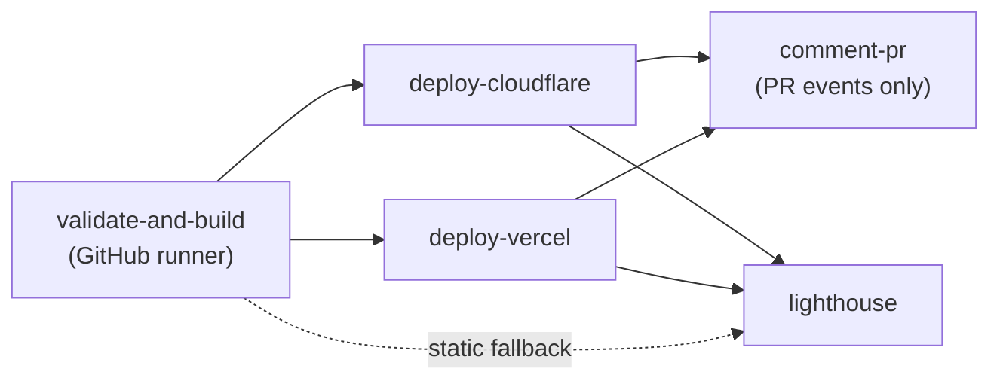

# Usage Guide

This guide covers deploying with the Shared CI/CD Framework. For the project overview, see [README.md](README.md).

Deploy any static or framework-based web application to **Cloudflare Workers** and/or **Vercel** with a single reusable workflow — or compose the individual actions yourself.

The framework handles runtime setup, package-manager and output-directory detection, builds, multi-platform deployment, pull-request preview comments, and Lighthouse audits. Consumers add a ~15-line workflow file and inherit every future improvement through the floating `@v2` tag.

---

## Contents

- [Requirements](#requirements)
- [Quick Start](#quick-start)
- [How a Deployment Runs](#how-a-deployment-runs)
- [Deployment Patterns](#deployment-patterns)
  - [Static or zero-dependency site](#static-or-zero-dependency-site)
  - [Framework application](#framework-application)
  - [Monorepo / subdirectory app](#monorepo--subdirectory-app)
  - [Multi-cloud](#multi-cloud)
  - [Remote builds (quota saver)](#remote-builds-quota-saver)
  - [No build / prebuilt artifacts](#no-build--prebuilt-artifacts)
- [Configuration Reference](#configuration-reference)
  - [Inputs](#inputs)
  - [Secrets](#secrets)
  - [Build-time environment variables](#build-time-environment-variables)
  - [Caller permissions](#caller-permissions)
  - [Environments](#environments)
- [Composite Actions](#composite-actions)
- [Auxiliary Workflows](#auxiliary-workflows)
- [Framework Recipes](#framework-recipes)
- [Troubleshooting](#troubleshooting)
- [Migrating from v1 (Pages)](#migrating-from-v1-pages)
- [Versioning & Releases](#versioning--releases)

---

## Requirements

- A GitHub repository containing a static site or a buildable web app.
- This repository must be accessible to the caller:
  - **Public** — works as-is.
  - **Private / internal** — enable **Settings → Actions → General → Access → Accessible from repositories in the organization**.
- The credentials for whichever platform(s) you enable (see [Secrets](#secrets)).
- The caller workflow must grant `contents: read`, `pull-requests: write`, and `deployments: write` (see [Caller permissions](#caller-permissions)).

---

## Quick Start

### 1. Configure credentials

Add the secrets once at the **organization** level (recommended) or per repository:

> **Organization Settings → Secrets and variables → Actions → New organization secret**

| Secret | Needed when | Notes |
| :--- | :--- | :--- |
| `CLOUDFLARE_API_TOKEN` | Deploying to Cloudflare via Wrangler | Token with `Account → Workers Scripts → Edit` |
| `CLOUDFLARE_ACCOUNT_ID` | Deploying to Cloudflare via Wrangler, unless `cloudflare_account_id` is set | 32-character hexadecimal account ID |
| `CLOUDFLARE_DEPLOY_HOOK_URL` | Remote Cloudflare builds | Optional; when set, it **takes precedence** over Wrangler |
| `VERCEL_TOKEN` | Deploying to Vercel | Personal or automation token |

If you deploy to Vercel, also add repository **variables** (not secrets):

- `VERCEL_PROJECT_ID`
- `VERCEL_ORG_ID`

### 2. Add the caller workflow

Create `.github/workflows/ci-cd.yml` in your project:

```yaml
name: CI/CD Pipeline

on:
  push:
    branches: [ "main" ]
  pull_request:
    branches: [ "main" ]
  workflow_dispatch:

concurrency:
  group: ${{ github.workflow }}-${{ github.ref }}
  cancel-in-progress: true

permissions:
  contents: read
  pull-requests: write
  deployments: write

jobs:
  deploy:
    uses: LABEIM/shared-ci-cd/.github/workflows/deploy-app.yml@v2
    with:
      enable_cloudflare: true
      cloudflare_project_name: 'my-web-app'
    secrets: inherit
```

Replace `LABEIM/shared-ci-cd` with your fork or organization path if different.

> [!WARNING]
> Changing your caller's `uses:` line is not enough on a fork. The reusable workflow hardcodes its own composite action refs, because `uses:` cannot take an input, so a fork must also edit all five in `.github/workflows/deploy-app.yml`:
>
> - `LABEIM/shared-ci-cd/actions/setup-and-build@v2`
> - `LABEIM/shared-ci-cd/actions/deploy-cloudflare@v2`
> - `LABEIM/shared-ci-cd/actions/deploy-vercel@v2`
> - `LABEIM/shared-ci-cd/actions/pr-preview-comment@v2`
> - `LABEIM/shared-ci-cd/actions/lighthouse-audit@v2`
>
> Otherwise the fork runs upstream's action code at the mutable `@v2` tag with the fork's own Cloudflare and Vercel tokens.

### 3. Push

Push to `main` for a production deployment, or open a pull request for a preview deployment and an automatic PR comment.

---

## How a Deployment Runs



| Stage | Runs when | Timeout | What it does |
| :--- | :--- | :---: | :--- |
| `validate-and-build` | `build_location` is `github`, `auto`, or empty | 15 min | Detects the runtime/package manager, installs, runs the optional check, builds, stages output, uploads `dist-static-build`. |
| `deploy-cloudflare` | `enable_cloudflare` is `true` | 10 min | Deploys via Wrangler or triggers a Deploy Hook, then resolves the live/preview URL. |
| `deploy-vercel` | `enable_vercel` is `true` | 10 min | Deploys prebuilt output via the Build Output API v3, or delegates the build to Vercel. |
| `comment-pr` | `enable_pr_comment` is `true` and the event is `pull_request` | 5 min | Creates or updates the single preview comment. |
| `lighthouse` | `enable_lighthouse` is `true` | 10 min | Audits the deployed URL (Cloudflare first, then Vercel, then static fallback) and reports scores. |

Production vs. preview (both providers):

- A non-`pull_request` run deploys to production only when its branch equals `production_branch` (default `main`). Every other branch deploys a preview.
- `pull_request` events are always previews, even from a branch named `main`.
- Tag and release events are previews too: their ref is the tag, not the production branch.
- The GitHub Environment follows the same rule: `*-production` only for the production branch, `*-preview` otherwise.

The build artifact `dist-static-build` is kept for 3 days. It includes hidden files such as `.well-known/security.txt`; `.env*`, `.dev.vars*`, `.npmrc`, `.yarnrc*`, `.netrc`, `.ssh`, `.aws`, `.docker`, `*.pem`, and `.git` are excluded. `dist_dir` must resolve inside the workspace, not its root.

---

## Deployment Patterns

### Static or zero-dependency site

No `package.json`, no install, no build. The workflow stages root files (or a `public/` folder) automatically.

```yaml
jobs:
  deploy:
    uses: LABEIM/shared-ci-cd/.github/workflows/deploy-app.yml@v2
    with:
      enable_cloudflare: true
      cloudflare_project_name: 'my-static-site'
    secrets: inherit
```

If your files live somewhere non-standard, set `dist_dir` explicitly (for example `dist_dir: 'public'`).

### Framework application

```yaml
jobs:
  deploy:
    uses: LABEIM/shared-ci-cd/.github/workflows/deploy-app.yml@v2
    with:
      node_version: '22'
      package_manager: 'auto'
      build_command: 'npm run build'
      check_command: 'npm run lint'   # optional
      dist_dir: 'auto'
      enable_cloudflare: true
      cloudflare_project_name: 'my-web-app'
      enable_vercel: false
      lighthouse_routes: |
        /
        /about
        /contact
    secrets: inherit
```

### Monorepo / subdirectory app

```yaml
jobs:
  deploy:
    uses: LABEIM/shared-ci-cd/.github/workflows/deploy-app.yml@v2
    with:
      working_directory: 'apps/web'
      package_manager: 'auto'
      dist_dir: 'auto'
      enable_cloudflare: true
      cloudflare_project_name: 'monorepo-web-app'
    secrets: inherit
```

> [!NOTE]
> Lockfile detection runs **inside `working_directory`**. If your workspace keeps a single lockfile at the repository root (common with pnpm/yarn workspaces), set `package_manager` explicitly — otherwise it falls back to npm.

### Multi-cloud

Both platforms deploy in parallel from the same build:

```yaml
jobs:
  deploy:
    uses: LABEIM/shared-ci-cd/.github/workflows/deploy-app.yml@v2
    with:
      package_manager: 'auto'
      dist_dir: 'auto'

      enable_cloudflare: true
      cloudflare_project_name: 'production-store'

      enable_vercel: true
      vercel_project_id: ${{ vars.VERCEL_PROJECT_ID }}
      vercel_org_id: ${{ vars.VERCEL_ORG_ID }}
    secrets: inherit
```

### Remote builds (quota saver)

For private repositories with limited GitHub Actions minutes, skip the GitHub build entirely and let the platform compile.

**Vercel remote build** — consumes 0 GitHub build minutes:

```yaml
with:
  build_location: 'vercel'
  enable_vercel: true
  vercel_project_id: ${{ vars.VERCEL_PROJECT_ID }}
  vercel_org_id: ${{ vars.VERCEL_ORG_ID }}
  enable_cloudflare: false
```

**Cloudflare remote build** — requires `CLOUDFLARE_DEPLOY_HOOK_URL`:

```yaml
with:
  build_location: 'cloudflare'
  enable_cloudflare: true
  cloudflare_project_name: 'my-cf-app'
  enable_vercel: false
```

> [!IMPORTANT]
> If `CLOUDFLARE_DEPLOY_HOOK_URL` is configured, the Cloudflare job always uses the hook (remote build) instead of Wrangler — regardless of `build_location`.
> The hook response carries no deployment URL; `deploy_url` is resolved from the account's `workers.dev` subdomain and is empty when the token or account ID is absent. Workers Builds also needs a committed Wrangler config with the build command and assets directory.

### No build / prebuilt artifacts

Use `build_location: 'none'` when the output is committed or produced by an earlier job. Cloudflare deploys the existing `dist_dir` contents.

> [!NOTE]
> For Vercel, `'none'` deploys prebuilt output, so the repository must already contain a valid `.vercel/output/` directory. If you want Vercel to compile the project, use `build_location: 'vercel'` instead.

If the resolved directory is missing, empty, or has no `index.html`, the workflow generates a small "Deployment Active" bootstrap page so the deployment does not fail. Treat that page as a signal that your `dist_dir` or `build_command` is wrong. On Cloudflare, SSR builds (`<dist_dir>/server/wrangler.json`) skip the placeholder because their site is served by the Worker; the Vercel and Lighthouse fallbacks still scaffold one if `client/index.html` is missing.

### Build location comparison

| Strategy | `build_location` | GitHub runner cost | Platform quota used | Best for |
| :--- | :---: | :---: | :---: | :--- |
| GitHub build | `'github'` (default) | Full build | 0 | Public repos, multi-cloud sync, centralized lockfile verification |
| Vercel remote | `'vercel'` | ~CLI trigger only | Vercel build minutes | Private repos, SSR/ISR/Edge on Vercel |
| Cloudflare remote | `'cloudflare'` | Deploy Hook only | Cloudflare free builds | Private repos, Workers Builds git projects |
| No build | `'none'` | Direct upload only | 0 | Vanilla sites, committed/prebuilt artifacts |

---

## Configuration Reference

### Inputs

All inputs are optional unless noted. All are declared under `with:`.

| Input | Type | Default | Description |
| :--- | :---: | :---: | :--- |
| `working_directory` | string | `'.'` | Subdirectory to build/deploy (monorepos). |
| `build_location` | string | `'github'` | `'github'`, `'vercel'`, `'cloudflare'`, or `'none'`. |
| `node_version` | string | `'22'` | Node version, or `'auto'` to read `.nvmrc` / `.node-version`. |
| `package_manager` | string | `'auto'` | `'auto'`, `'npm'`, `'pnpm'`, `'bun'`, `'yarn'`, `'none'`, or `'static'`. |
| `install_command` | string | `''` | Custom install command, or `'none'` to skip. |
| `check_command` | string | `''` | Optional lint/typecheck command (e.g. `npx astro check`). |
| `build_command` | string | `'npm run build'` | Build command; `'none'` skips, `'auto'` runs the package `build` script when present. |
| `dist_dir` | string | `'dist'` | Output directory, or `'auto'` to detect standard folders. |
| `enable_cloudflare` | boolean | `true` | Deploy to Cloudflare Workers. |
| `cloudflare_project_name` | string | `''` | Cloudflare Worker name (defaults to the repository name). |
| `production_branch` | string | `'main'` | Branch that deploys to production on both Cloudflare and Vercel; other branches deploy previews. |
| `cloudflare_mode` | string | `'auto'` | `'auto'`, `'static'`, or `'ssr'`. `auto` deploys a Worker + assets when `<dist_dir>/server/wrangler.json` exists, otherwise static assets. |
| `cloudflare_account_id` | string | `''` | Cloudflare account ID as a non-secret value; falls back to the `CLOUDFLARE_ACCOUNT_ID` secret. |
| `enable_vercel` | boolean | `false` | Deploy to Vercel. |
| `vercel_project_id` | string | `''` | Vercel project ID (required when Vercel is enabled). |
| `vercel_org_id` | string | `''` | Vercel organization/team ID (required when Vercel is enabled). |
| `enable_pr_comment` | boolean | `true` | Post/update the PR preview comment. |
| `enable_lighthouse` | boolean | `true` | Run the Lighthouse audit. |
| `lighthouse_routes` | string | `'/'` | Space- or newline-separated routes to audit. |
| `lighthouse_config_path` | string | `''` | Path to a custom Lighthouse CI config. |

**Output auto-detection order:** `dist` → `out` → `build` → `.output/public` → `_site` → `site` → `public` → root `index.html`.

**Package-manager auto-detection:** `pnpm-lock.yaml` → `bun.lockb` / `bun.lock` → `yarn.lock` → `package-lock.json` / `npm-shrinkwrap.json` → npm; if `package.json` is absent, no install/build is attempted.

### Secrets

Pass them with `secrets: inherit` (organization/repository secrets) or explicitly under `secrets:`.

| Secret | Required | Description |
| :--- | :---: | :--- |
| `CLOUDFLARE_API_TOKEN` | Cloudflare via Wrangler | Token with Workers Scripts edit permission. |
| `CLOUDFLARE_ACCOUNT_ID` | Cloudflare via Wrangler, unless `cloudflare_account_id` is set | Cloudflare account ID. |
| `CLOUDFLARE_DEPLOY_HOOK_URL` | Cloudflare remote build | Deploy Hook URL; takes precedence over Wrangler. |
| `VERCEL_TOKEN` | Vercel | Vercel personal/automation token. |

Never commit these values. Keep `.env`, `.env.local`, and credential files out of the repository.

Identifiers (`VERCEL_PROJECT_ID`, `VERCEL_ORG_ID`) are repository **variables**, not secrets; the examples read them via `vars.*`. The Cloudflare account ID can also be a variable: pass it with `cloudflare_account_id` and the `CLOUDFLARE_ACCOUNT_ID` secret is used only when that input is empty.

Deployment credentials may live in the `cloudflare-production` / `cloudflare-preview` and `vercel-production` / `vercel-preview` environments. Environment secrets require a public repository on GitHub Free; private repositories on Free must use repository secrets.

### Build-time environment variables

When the site is built on the runner (`build_location: github`, the default), every inherited secret or repository/organization variable whose name starts with `PUBLIC_` is exported into the build environment before the build command runs. The prefix is case-sensitive: nothing else is exported, and the step logs the exported names only, never the values. When both a variable and a secret share a name, the variable wins when the variable is non-empty. If a non-empty variable and the secret hold different values, the build fails before it starts and names the conflicting keys, so a typo cannot silently change the build config; keep the two in sync or remove one. An empty variable does not override the secret.

This is how callers pass build-time configuration to frameworks that inline environment variables into the static output. GitHub does not allow the `secrets` context inside `with:`, so secret values must arrive through `secrets: inherit`; `PUBLIC_*` variables are read from the caller's repository automatically:

```yaml
jobs:
  deploy:
    uses: LABEIM/shared-ci-cd/.github/workflows/deploy-app.yml@v2
    with:
      cloudflare_project_name: 'my-astro-site'
    # PUBLIC_GOOGLE_SHEET_SCRIPT_URL, PUBLIC_RECRUITMENT_SECRET, ... are inherited or read as variables here
    secrets: inherit
```

An Astro site can then read them at build time:

```astro
---
const sheetUrl = import.meta.env.PUBLIC_GOOGLE_SHEET_SCRIPT_URL;
---
```

> [!WARNING]
> The `PUBLIC_` prefix is only for values intended to ship to the browser. Everything exported this way is inlined into the static output and is readable by every visitor. Never give a token, API key, or deployment credential a `PUBLIC_` name.

### Caller permissions

Declare the minimum permissions at the caller workflow or job level:

```yaml
permissions:
  contents: read        # checkout
  pull-requests: write  # PR preview comment (omit if enable_pr_comment: false)
  deployments: write    # environment/deployment URLs
```

Secrets are not available to `pull_request` runs from forks. If you deploy previews from forks, use `pull_request_target` carefully and never execute untrusted code with secrets.

### Environments

The workflow publishes to GitHub Environments:

- `cloudflare-preview` / `cloudflare-production`
- `vercel-preview` / `vercel-production`

You can attach protection rules (required reviewers, wait timers, deployment branch policies) in **Settings → Environments**. The workflow picks the environment with the same rule it uses for production: a non-`pull_request` run of `production_branch` uses the `*-production` environment, everything else uses `*-preview`.

---

## Composite Actions

Use these directly when you need custom Docker builds, extra gates, or non-standard deployment steps. All actions are composite; call them from an `ubuntu-latest` job. The Cloudflare action needs `jq`, GNU `grep -P`, `realpath`, and Node >= 22.12 on the runner (`ubuntu-latest` has them all).

| Action | Purpose | Key inputs | Outputs |
| :--- | :--- | :--- | :--- |
| [`actions/setup-and-build`](actions/setup-and-build/action.yml) | Runtime setup, dependency install, check, build, stage output, upload artifact | `node_version`, `package_manager`, `install_command`, `check_command`, `build_command`, `dist_dir`, `project_name`, `artifact_name`, `artifact_retention_days` | `artifact_hash`, `build_duration`, `detected_package_manager`, `resolved_dist_dir` |
| [`actions/deploy-cloudflare`](actions/deploy-cloudflare/action.yml) | Workers deploy (static assets or Worker + assets) or Deploy Hook trigger, with retries and URL resolution | `project_name` *(optional; defaults to the repository name, sanitized)*, `dist_dir`, `cloudflare_mode`, `not_found_handling`, `production_branch`, `api_token`, `account_id`, `deploy_hook_url`, `max_retries`, `retry_delay` | `deploy_url`, `is_production` |
| [`actions/deploy-vercel`](actions/deploy-vercel/action.yml) | Build Output API v3 deploy or remote Vercel build | `project_id` *(required)*, `org_id` *(required)*, `vercel_token` *(required)*, `dist_dir`, `remote_build`, `prepare_output`, `max_retries`, `retry_delay` | `deploy_url`, `is_production` |
| [`actions/pr-preview-comment`](actions/pr-preview-comment/action.yml) | Create or update the single preview comment | `cloudflare_url`, `vercel_url`, `custom_message`, `github_token` | — |
| [`actions/lighthouse-audit`](actions/lighthouse-audit/action.yml) | Run Lighthouse CI and summarize scores; static audits resolve `dist_dir` under `working_directory` | `target_url`, `routes`, `config_path`, `dist_dir`, `append_to_pr`, `github_token` | `summary_markdown` |

The reusable [`deploy-app.yml`](.github/workflows/deploy-app.yml) workflow is composed of these same actions, referenced at `@v2`; workflow and actions move together in a release.

`not_found_handling` controls unmatched paths: `auto` (default) uses `404-page` when `dist_dir/404.html` exists and `single-page-application` otherwise. Set it explicitly to override that guess; any other value fails the step. It applies to direct Wrangler uploads only; remote Workers Builds use the consumer's committed Wrangler config instead. A committed `wrangler.json`/`wrangler.toml` is ignored for direct uploads: the generated config is the whole deployment config.

`cloudflare_mode` selects the deployment shape. `auto` (default) deploys a Worker + assets when `<dist_dir>/server/wrangler.json` exists (emitted by `@astrojs/cloudflare` 14+), otherwise static assets. `ssr` forces the Worker shape and fails if that config is missing; `static` forces assets only. In `ssr` mode `not_found_handling` has no effect (still validated), because unmatched paths must reach the Worker. See [Astro + Keystatic](#astro--keystatic-worker--assets).

A production direct upload serves the Worker at `<sanitized-worker>.<subdomain>.workers.dev`; each pull-request preview serves at `<sanitized-branch>-<sanitized-worker>.<subdomain>.workers.dev`. Direct uploads always set `workers_dev` and `preview_urls`, so a custom domain does not hide that surface.

Example custom pipeline:

```yaml
jobs:
  build-and-deploy:
    runs-on: ubuntu-latest
    permissions:
      contents: read
      pull-requests: write
      deployments: write
    steps:
      - uses: actions/checkout@v5

      - name: Build site
        uses: LABEIM/shared-ci-cd/actions/setup-and-build@v2
        with:
          package_manager: 'auto'
          build_command: 'npm run build'
          dist_dir: 'auto'

      - name: Deploy to Cloudflare
        id: cf
        uses: LABEIM/shared-ci-cd/actions/deploy-cloudflare@v2
        with:
          project_name: 'my-custom-app'
          dist_dir: 'dist'
          api_token: ${{ secrets.CLOUDFLARE_API_TOKEN }}
          account_id: ${{ secrets.CLOUDFLARE_ACCOUNT_ID }}

      - name: Post PR comment
        if: github.event_name == 'pull_request'
        uses: LABEIM/shared-ci-cd/actions/pr-preview-comment@v2
        with:
          cloudflare_url: ${{ steps.cf.outputs.deploy_url }}
```

---

## Auxiliary Workflows

| Workflow | Trigger | Purpose |
| :--- | :--- | :--- |
| [`deploy-app.yml`](.github/workflows/deploy-app.yml) | `workflow_call` | The reusable deployment pipeline described above. |
| [`lint-ci.yml`](.github/workflows/lint-ci.yml) | Push/PR to `main` | `actionlint` and YAML syntax validation for this repository. |
| [`codeql-scan.yml`](.github/workflows/codeql-scan.yml) | Configurable | CodeQL static analysis for JavaScript/TypeScript, Python, and Go. |
| [`dependency-review.yml`](.github/workflows/dependency-review.yml) | Pull requests | Blocks high-severity vulnerable dependency changes. |
| [`stale-cleanup.yml`](.github/workflows/stale-cleanup.yml) | Schedule or `workflow_call` | Closes stale issues and pull requests. |
| [`dependabot-auto-merge.yml`](.github/workflows/dependabot-auto-merge.yml) | Dependabot PRs | Auto-merges safe dependency updates. |
| [`release-tagger.yml`](.github/workflows/release-tagger.yml) | Release published | Moves the floating major tag to the new release. |

---

## Framework Recipes

Add the relevant fragment under your caller job's `with:` block.

### Astro

```yaml
with:
  package_manager: 'auto'
  check_command: 'npx astro check'
  build_command: 'npm run build'
  dist_dir: 'dist'
```

### Astro + Keystatic (Worker + assets)

Keystatic's admin at `/keystatic` is server-rendered, so the site must deploy as a Worker with static assets, not assets alone. This requires Astro 7 with `@astrojs/cloudflare` 14+, which emits `dist/server/wrangler.json` and the assets in `dist/client`.

Install the runtime dependencies:

```bash
npm i @astrojs/cloudflare@^14 @astrojs/react react react-dom @keystatic/astro @keystatic/core
npm i -D @astrojs/check typescript   # required for `npx astro check` in CI
```

```yaml
with:
  package_manager: 'auto'
  check_command: 'npx astro check'
  build_command: 'npm run build'
  dist_dir: 'dist'          # build root, not dist/client
  cloudflare_mode: 'ssr'    # or 'auto' to detect dist/server/wrangler.json
  lighthouse_routes: |
    /
```

`astro.config.mjs`:

```js
import cloudflare from '@astrojs/cloudflare';
import keystatic from '@keystatic/astro';
import react from '@astrojs/react';
import { defineConfig } from 'astro/config';

export default defineConfig({
  output: 'static',
  session: false,
  adapter: cloudflare(),
  integrations: [react(), keystatic()],
});
```

`keystatic.config.ts` uses Keystatic Cloud in production and local storage in development:

```ts
import { config } from '@keystatic/core';

export default config({
  storage: process.env.NODE_ENV === 'development' ? { kind: 'local' } : { kind: 'cloud' },
  cloud: { project: 'your-team/your-project' },
  collections: { /* ... */ },
});
```

1. Create a Keystatic Cloud team and project, and connect the repository. The free tier covers up to 3 users.
2. Deploy with `cloudflare_mode: 'ssr'` (or `auto`) and `dist_dir: 'dist'`.
3. Open `/keystatic` on the deployed URL.

Keystatic's GitHub storage mode is not supported on Workers by this pipeline (upstream OAuth bug); use Cloud storage.

> [!NOTE]
> `ssr` deploys the config emitted by `@astrojs/cloudflare`, overriding only the Worker name and preview flags. The adapter's `ASSETS` binding is preserved, so unmatched paths fall through to the Worker. Keystatic Cloud handles authentication; no secrets are added to the Worker.

> [!WARNING]
> `dist_dir` must be the build root (`dist`). With `auto` or `static`, `dist_dir: 'dist/client'` deploys static assets only and `/keystatic` returns 404 with no warning; with `ssr` it fails before deploying. Forcing `static` on an SSR build also fails, because `dist` would publish `dist/server` as public assets — use `dist_dir: 'dist/client'` if you really want the assets only.

> [!NOTE]
> `not_found_handling` has no effect in `ssr` mode but is still validated. Astro 5/6 builds that emit `dist/_worker.js` fall back to static under `auto`; forcing `ssr` fails with an adapter error. Keep `/keystatic` out of `lighthouse_routes` (the admin requires authentication). PR previews render the admin, but edits are committed to the branch configured in Keystatic Cloud, not necessarily the PR branch, and content is baked at build time — saved edits reach production only after that branch is pushed and rebuilt. The deploy-hook (Workers Builds) path ignores the generated config, so commit a Wrangler config with `main` and `assets` instead. If you enable Vercel as a backup, it serves the prerendered `client/` assets only; dynamic routes such as `/keystatic` are not available there. The Lighthouse static fallback also audits `client/` for SSR builds.

### Next.js

```yaml
# Built on Vercel (zero GitHub build minutes)
with:
  build_location: 'vercel'
  enable_vercel: true
  vercel_project_id: ${{ vars.VERCEL_PROJECT_ID }}
  vercel_org_id: ${{ vars.VERCEL_ORG_ID }}

# Or built on GitHub as a static export
with:
  package_manager: 'auto'
  build_command: 'npm run build'
  dist_dir: 'out'
```

### Nuxt

```yaml
with:
  package_manager: 'auto'
  build_command: 'npx nuxi generate'
  dist_dir: '.output/public'
```

### Vite (React / Vue / Svelte)

```yaml
with:
  package_manager: 'auto'
  build_command: 'npm run build'
  dist_dir: 'dist'
```

### Hugo / Jekyll / MkDocs

```yaml
with:
  package_manager: 'none'
  dist_dir: 'public'   # Hugo: public, Jekyll: _site, MkDocs: site
```

### Plain HTML / CSS / JS

```yaml
with:
  enable_cloudflare: true
  cloudflare_project_name: 'my-static-site'
```

---

## Troubleshooting

**The site shows a "Deployment Active" placeholder page.**
The resolved output directory is missing, empty, or has no `index.html`, so the workflow scaffolded a fallback. Set `dist_dir` explicitly or fix `build_command`; check the build log for the resolved directory.

**No install or build happened.**
No `package.json` was found in `working_directory`. That is intentional for static sites. If this is a framework app, fix `working_directory` or `package_manager`.

**pnpm/yarn workspace installs with npm.**
Lockfile detection only looks inside `working_directory`. Set `package_manager: 'pnpm'` (or `yarn`) explicitly when the lockfile is at the repository root.

**Cloudflare fails with missing credentials.**
Set both `CLOUDFLARE_API_TOKEN` and `CLOUDFLARE_ACCOUNT_ID`, or configure `CLOUDFLARE_DEPLOY_HOOK_URL` to use a remote build. A configured hook wins over Wrangler.

**Vercel fails with missing credentials.**
Provide the `VERCEL_TOKEN` secret and both `vercel_project_id` / `vercel_org_id` inputs. IDs can come from repository variables.

**No PR comment appears.**
The comment job only runs on `pull_request` events with `enable_pr_comment: true`, and the caller must grant `pull-requests: write`. Fork PRs do not receive secrets.

**Lighthouse scores look wrong.**
Lighthouse audits the Cloudflare URL first, then Vercel, then the static build. Make sure every route in `lighthouse_routes` exists and is publicly reachable; a 404 page will score poorly.

**A deployment ran but the wrong branch is production.**
Production requires a non-`pull_request` run whose branch equals `production_branch` (default `main`). A push to any other branch, a tag, or a release deploys a preview. Set `production_branch` if your production branch is not `main`.

**The job is green but `deploy_url` is empty.**
The Worker URL could not be resolved from the command output or the account's `workers.dev` subdomain. Check that the subdomain is registered, that the token can read Workers Scripts, and that the log contains a `*.workers.dev` URL. Lighthouse falls back to the static build in that case.

**The deploy step fails with `dist_dir must resolve inside the workspace` or `max_retries must be a positive integer`.**
`dist_dir` must point inside the checked-out repository (not `..`, an absolute path, or the repo root), and `max_retries` must be a positive integer.

**Workflow cannot be called.**
For private/internal shared repositories, enable **Settings → Actions → General → Access → Accessible from repositories in the organization**.

---

## Migrating from v1 (Pages)

Version 2 deploys to Cloudflare Workers instead of Pages. Pages support is removed.

1. Confirm no unrelated Worker already uses the name this pipeline derives (Workers and Pages are separate namespaces).
2. Confirm the account's `workers.dev` subdomain is registered and enabled.
3. Change the workflow ref to `@v2` and deploy `main` once.
4. Re-point any custom domain from the Pages project to the Worker. The zone must be active on Cloudflare; hostnames on external DNS need Cloudflare for SaaS custom hostnames.
5. If you deploy with `CLOUDFLARE_DEPLOY_HOOK_URL`: create a Workers Builds deploy hook, update the secret, and commit a Wrangler config with the build command and assets directory. A Pages hook will not build the Worker.
6. Optionally delete the old Pages project.

## Versioning & Releases

Consumers pin the floating major tag:

```yaml
uses: LABEIM/shared-ci-cd/.github/workflows/deploy-app.yml@v2
```

Non-breaking changes update `v2` automatically. Breaking changes — contract or deployment platform — require a new major tag (`v3`). See [`RELEASING.md`](RELEASING.md) for the full procedure and checklist.
